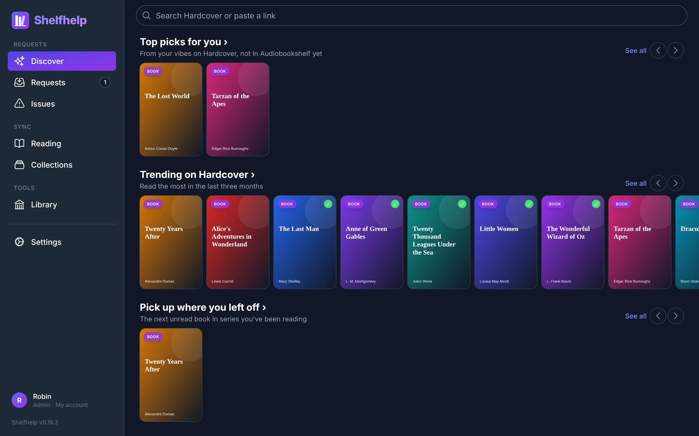
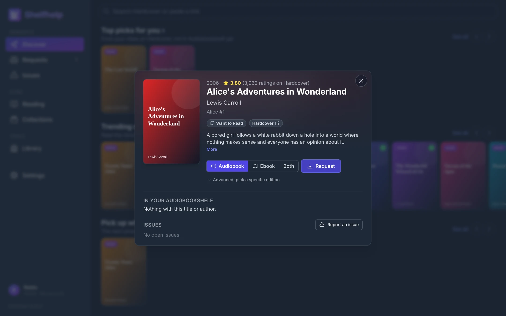
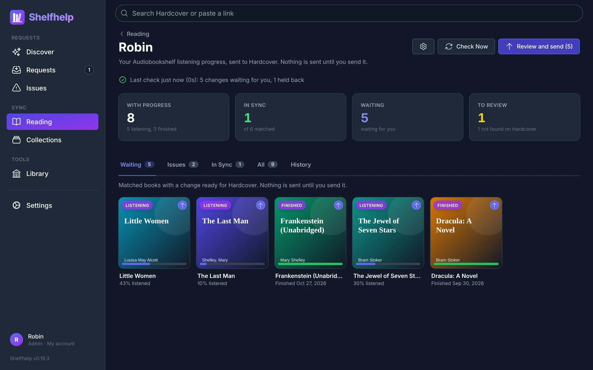

# Shelfhelp

Shelfhelp connects [Audiobookshelf](https://www.audiobookshelf.org/), [Hardcover](https://hardcover.app) and [Chaptarr](https://github.com/Chaptarr/chaptarr): discover and request books, send your Audiobookshelf listening progress to Hardcover, and keep Audiobookshelf collections in sync with Hardcover lists.



## AI DISCLOSURE

THIS IS VIBE CODED. I DO NOT RECOMEND ANYONE EXPOSE THIS TO THE INTERNET DIRECTLY. My solution has been to put it behind a cloudflare authentication page which authenticates with my Pocket ID.

Although this is publicly listed, this is for my personal use. Given that this is vibe coded and its for my personal use, I make no promises things will be fixed. All that said it works pretty well for me, my homelab, and users.

## What it does

**Discover and request.** Rows of trending, new and recommended books, with a check mark on what you already own. Tap a book to see what's in Audiobookshelf, add it to your Want to Read, or request it from Chaptarr as an audiobook, ebook or both (down to a specific edition or narrator).



**Reading sync.** Your Audiobookshelf listening progress goes to Hardcover: started books become Currently Reading, finished ones become Read with their dates. Nothing is sent until you review it (or turn on sending automatically), and anything sent can be undone.



**Collections.** Pick a Hardcover list or shelf and a library, and Shelfhelp keeps a matching Audiobookshelf collection. Messy titles, wrong ASINs and "Last, First" authors are handled; anything uncertain waits for you to check.

**Also:** Issues for reporting problems with a book, a Library page that links every Audiobookshelf book to Hardcover, and per-person sign-in so everyone gets their own Discover, requests and reading.

## Install

```yaml
services:
  shelfhelp:
    image: ghcr.io/nathanapples/shelfhelp:latest
    container_name: shelfhelp
    environment:
      - PUID=1000
      - PGID=1000
      - TZ=Etc/UTC
    volumes:
      - ./config:/config
    ports:
      - 5075:5075
    restart: unless-stopped
```

`docker compose up -d`, open `http://<host>:5075`, and Settings walks you through:

1. **Hardcover server key** from [hardcover.app/account/api](https://hardcover.app/account/api), with `read:catalog`, `read:lists`, `read:prompts` and `read:social`. Used for shared data only. `read:social` is what lets it read other people's public lists; `read:lists` alone covers only the key's own account.
2. **Audiobookshelf** URL and an admin API key.
3. Optional: **Chaptarr** for requests, a **sign-in** (Pocket ID or Cloudflare Access), and **Sign in with Hardcover** (make a web app under Developer apps on hardcover.app with the redirect link Settings shows).

Each person connects their own Hardcover account under My account, with Connect with Hardcover or an API key.

### Environment variables

Everything can be set in the UI; these pin a setting or cover emergencies.

| Variable | Purpose |
|---|---|
| `PUID` / `PGID` / `TZ` / `UMASK` | Container user, group, time zone, umask |
| `APP_PASSWORD` | A password to open Shelfhelp, or an emergency admin sign-in when sign-in is on |
| `AUTH_MODE` | `none`, `oidc` or `cloudflare`. Set `none` to get back in if sign-in breaks |
| `LOG_RECOVERY_LINK` | `true` lets "Can't sign in?" write a one-time admin link to the container log. Off by default |
| `OIDC_ISSUER` / `OIDC_CLIENT_ID` / `OIDC_CLIENT_SECRET` / `OIDC_INTERNAL_URL` / `OIDC_ADMIN_GROUP` | Pocket ID (or another OpenID Connect provider) |
| `CF_ACCESS_TEAM_DOMAIN` / `CF_ACCESS_AUD` | Cloudflare Access |
| `HARDCOVER_TOKEN` | Hardcover server key |
| `HARDCOVER_CLIENT_ID` / `HARDCOVER_CLIENT_SECRET` | Hardcover developer app for Sign in with Hardcover |
| `ABS_URL` / `ABS_TOKEN` | Audiobookshelf |
| `CHAPTARR_URL` / `CHAPTARR_API_KEY` | Chaptarr |
| `SYNC_INTERVAL_MINUTES` | Sync schedule, default 360 (0 turns it off) |

Everything Shelfhelp keeps lives in `/config/shelfhelp.db`. Releases are tagged (`:0.19`, `:0.19.3`, `:latest`); see [CHANGELOG.md](CHANGELOG.md).

## Development

```bash
npm install
npx tsx test/mock-servers.ts   # fake Hardcover, Audiobookshelf, Chaptarr and Pocket ID
HARDCOVER_ENDPOINT=http://localhost:5091/v1/graphql HARDCOVER_TOKEN=x \
  ABS_URL=http://localhost:5092 ABS_TOKEN=x \
  CHAPTARR_URL=http://localhost:5093 CHAPTARR_API_KEY=chaptarr-key CONFIG_DIR=./config npm run dev:server
npm run dev:web                # http://localhost:5173
npm test
```

The mock servers use public-domain books, which is what the screenshots show. Built with the [Hardcover TypeScript SDK](https://github.com/hardcoverapp/hardcover-sdk), Fastify, React and Tailwind. Some reading sync rules follow [ShelfBridge](https://github.com/rohit-purandare/ShelfBridge) and [audiobookshelf-hardcover-sync](https://github.com/drallgood/audiobookshelf-hardcover-sync).

## License

MIT
